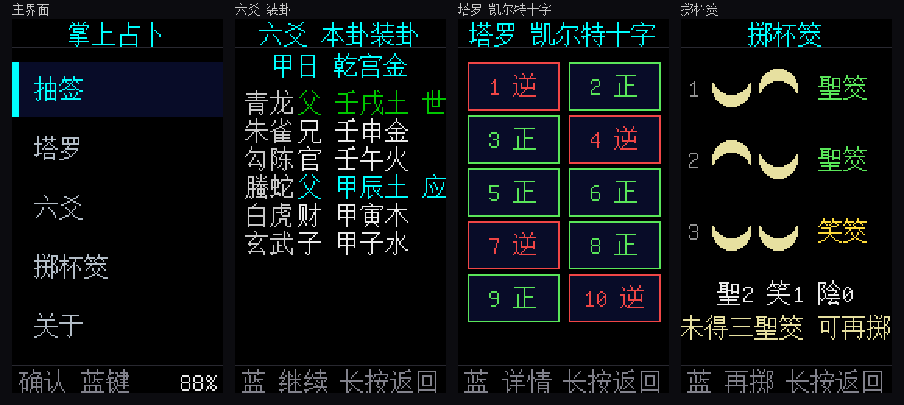

# Palm Divination · StickS3

[](https://github.com/LamZaakDok/zhangshang-zhanbu/actions/workflows/build.yml)
[](LICENSE)

[中文](README.md) | **English**

A pocket divination firmware for **M5Stack StickS3** (ESP32-S3), with four modes:

**Lots (抽签) · Tarot · I-Ching Six Lines (六爻) · Moon Blocks (掷杯筊)**

<p align="center">
  
  
  
</p>

## Features

| Mode | Description |
|---|---|
| **Lots** | Three temple sets (Lingyin / Wong Tai Sin / Senso-ji), 100 lots each with poems and modern interpretation, drawn by each temple's real fortune distribution; keeps the last 30 draws as history (NVS) |
| **Tarot** | 78 Rider–White–Smith illustrated cards; spreads: single / three (past·present·future) / Celtic Cross (10 cards); reversals shown rotated 180° |
| **Six Lines** | Three-coin method with shake-to-cast; full Na-Jia plate (8 palaces, Shi/Ying, stems-branches, five elements, six relations, six spirits); a "use-god" verdict by question type |
| **Moon Blocks** | Toss three times; one flat + one round = *Sheng* (yes), two flat = *Xiao*, two round = *Yin* (no); three *Sheng* = clear approval |

## Hardware

- **M5Stack StickS3**: ESP32-S3-PICO-1-N8R8 (8 MB flash + 8 MB PSRAM), 1.14" IPS 135×240, BMI270 IMU, mic/speaker, USB-C.
- Buttons: **blue key = confirm/continue**, **right button = down**, **long-press blue = back**. (Mapping in `src/input.h`.)

## Quick start

PlatformIO + Python with Pillow (`pip install pillow`).

```bash
# 1. Generate the Chinese bitmap font (downloads Unifont, embeds only used glyphs)
python tools/gen_font.py

# 2. Build & flash firmware
pio run -t upload

# 3. Upload assets (lot CSVs + tarot art + splash) to the filesystem
pio run -t uploadfs
```

> After editing files under `data/`, re-run `gen_font.py` then `pio run -t upload`; asset-only changes just need `uploadfs`.

## Data sources & license

- **Tarot art**: public-domain 1909 Rider–White–Smith deck from [`mixvlad/TarotCards`](https://github.com/mixvlad/TarotCards) (MIT).
- **Lots**: public datasets — [`yanxinyu777-beep/guanyin-lingqian-100`](https://github.com/yanxinyu777-beep/guanyin-lingqian-100), [`wickes1/wong-tai-sin`](https://github.com/wickes1/wong-tai-sin), [`Tamshen/senso-ji-stick-data`](https://github.com/Tamshen/senso-ji-stick-data).
- **Chinese font**: [GNU Unifont](https://unifoundry.com/unifont.html).
- This project's code: **MIT** (see [LICENSE](LICENSE)). Traditional texts are for study/entertainment only.

## Layout

```
fortune-stick/
├─ platformio.ini / partitions.csv   build config (3 MB app + ~4.9 MB SPIFFS)
├─ src/   main, ui, input, motion, draw_lots, tarot, liuyao, jiaobei, rng, store
├─ data/  filesystem assets (CSVs / tarot/ / splash.jpg / bless.jpg)
└─ tools/ generators (font / lots / tarot / splash / verify / docs)
```

## Tooling

| Script | Purpose |
|---|---|
| `tools/gen_font.py` | Scan `data/` + `src/`, build 16×16 CJK bitmap font (with missing-glyph check) |
| `tools/import_lots.py` | Lot JSON → CSV |
| `tools/fetch_tarot.py` | Download & resize the 78 card images |
| `tools/prepare_splash.py` / `make_splash.py` / `make_bless.py` | Boot screens |
| `tools/verify_gua.py` | Verify Na-Jia plate (relations / Shi-Ying) |
| `tools/make_docs.py` | Generate the README screenshots |

## Limitations

- 135×240 screen: long text is paginated; lines that don't fit scroll horizontally.
- Six Lines verdict is a concise version (based on the use-god holding Shi / moving, and its relations to Shi and the changed line); no month/day pillars, void, or hidden gods.
- The six spirits follow the day stem; there is no RTC, so the day stem is chosen manually.
- For entertainment only.

## CI

GitHub Actions runs on every push/PR: generate font → build firmware → build filesystem.
Releases (`v*` tags) additionally publish `firmware.bin`, `spiffs.bin` and a merged `zhangshang-zhanbu-full.bin`.

## Publish to M5Burner

Ready-to-publish material (cover / payload / merged image) is in [`m5burner/`](m5burner/README.md).
Log in with your M5Stack account in the M5Burner app and use **USER CUSTOM → Publish**.
