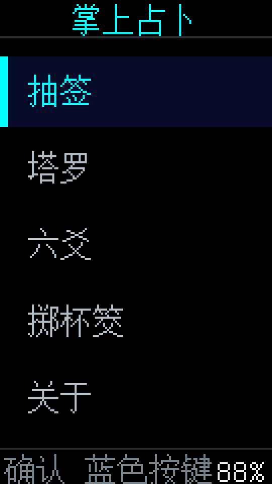

# 掌上占卜 · StickS3

[](https://github.com/LamZaakDok/zhangshang-zhanbu/actions/workflows/build.yml)
[](LICENSE)

基于 **M5Stack StickS3**（ESP32-S3）的掌上占卜固件，内置四个功能：

**抽签 · 塔罗 · 六爻 · 掷杯筊**

<p align="center">
  
  
  
</p>

## 功能

| 功能 | 说明 |
|---|---|
| **抽签** | 灵隐寺 · 观音灵签 / 黄大仙祠 · 灵签 / 浅草寺 · 观音签，各 100 签（真实签诗 + 白话解），按各庙真实吉凶分布抽取；含最近 30 次「历史签」 |
| **塔罗** | 78 张 Rider–White–Smith 插画牌面，单张 / 三张(过去·现在·未来) / 凯尔特十字(10 张)；逆位 180° 呈现 |
| **六爻** | 三枚铜钱法 + 摇一摇起卦；纳甲装卦：八宫、世应、干支、五行、六亲、六神（择日干）；择问事出用神断语 |
| **掷杯筊** | 连掷三次，一正一反=聖筊 / 两正=笑筊 / 两反=陰筊；三聖筊为明确允准 |

## 硬件

- **M5Stack StickS3**：ESP32-S3-PICO-1-N8R8（8MB Flash + 8MB PSRAM），1.14" IPS 135×240，BMI270 IMU，麦克风/喇叭，USB-C。
- 按键：**蓝色键 = 确认 / 继续**，**右侧按钮 = 下移**，**长按蓝键 = 返回**。
  （映射在 `src/input.h`，若左右相反改一处即可。）

## 快速开始

需要 [PlatformIO](https://platformio.org/) 与 Python + Pillow（`pip install pillow`）。

```bash
# 1. 生成中文字库(16x16 点阵, 自动下载 Unifont; 仅嵌入用到的字)
python tools/gen_font.py

# 2. 编译并上传固件
pio run -t upload

# 3. 上传素材到文件系统(签库 CSV + 塔罗图 + 启动图)
pio run -t uploadfs
```

> 改过 `data/` 文案后，重跑 `gen_font.py` 再 `pio run -t upload`；素材改动只需 `uploadfs`。

## 数据来源与许可

- **塔罗牌面**：公有领域的 1909 Rider–White–Smith 牌组，取自 [`mixvlad/TarotCards`](https://github.com/mixvlad/TarotCards)（MIT）。
- **签文**：公开数据集
  - 灵隐寺·观音灵签 [`yanxinyu777-beep/guanyin-lingqian-100`](https://github.com/yanxinyu777-beep/guanyin-lingqian-100)
  - 黄大仙祠·灵签 [`wickes1/wong-tai-sin`](https://github.com/wickes1/wong-tai-sin)
  - 浅草寺·观音签 [`Tamshen/senso-ji-stick-data`](https://github.com/Tamshen/senso-ji-stick-data)
- **中文字库**：[GNU Unifont](https://unifoundry.com/unifont.html)（GPL + 字体例外）。
- 本项目代码：**MIT**（见 [LICENSE](LICENSE)）。签文/牌义等传统内容仅供学习娱乐。

## 目录结构

```
fortune-stick/
├─ platformio.ini / partitions.csv   构建配置(3MB 应用 + ~4.9MB SPIFFS)
├─ src/
│  ├─ main.cpp      主菜单状态机
│  ├─ ui.*          中英混排渲染、分页、滚动、电量
│  ├─ input.h       按键映射(蓝键/右键/长按)
│  ├─ motion.h      摇一摇检测
│  ├─ draw_lots.cpp 抽签(3 庙系 + 历史)
│  ├─ tarot.cpp     塔罗(3 牌阵)
│  ├─ liuyao.cpp    六爻(纳甲装卦 + 用神)
│  ├─ jiaobei.cpp   掷杯筊(三掷)
│  └─ rng.h / store.h
├─ data/            文件系统素材(CSV / tarot/ / splash.jpg / bless.jpg)
└─ tools/           生成脚本(字库 / 签文 / 牌面 / 启动图 / 校验 / 示意)
```

## 工具

| 脚本 | 作用 |
|---|---|
| `tools/gen_font.py` | 扫描 `data/` 与 `src/`，生成 16×16 中文字库（含缺字检测） |
| `tools/import_lots.py` | 三家签文 JSON → CSV |
| `tools/fetch_tarot.py` | 下载并预处理 78 张牌面 |
| `tools/prepare_splash.py` / `make_splash.py` / `make_bless.py` | 启动图与"祝君好运" |
| `tools/verify_gua.py` | 六爻装卦校验（纳甲/六亲/世应） |
| `tools/make_docs.py` | 生成 README 界面示意图 |

## 已知限制

- 界面为 135×240，长文本自动分页；放不下的行横向滚动。
- 六爻用神断语为简明版（据用神持世/发动与世、变生克）；未含月建日辰、旬空、伏神。
- 六神依日干起，无 RTC，起卦前手动选择今日天干。
- 结果仅供娱乐。

## 构建状态

GitHub Actions 在每次 push / PR 时执行：生成字库 → 编译固件 → 打包文件系统。
